# FMCG Consumer Growth & Promotion Insights

Customer segmentation and promotion analytics to identify retention priorities and growth opportunities.

**PostgreSQL · Python · Power BI · Excel · PowerPoint**

**[View the live dashboard][dashboard]** · [Business questions](#the-business-questions) · [Key takeaways](#key-takeaways) · [Workflow](#workflow) · [Analysis files](#analysis-files)

## Explore the dashboard

Seven pages connect sales performance, shopper behavior and promotion patterns to business actions.

### Business overview

Sales, shoppers, basket value and purchasing activity in one view.

[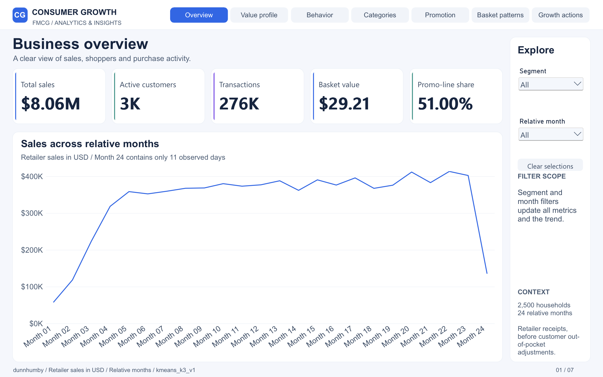][dashboard]

### Consumer value

**40.28% of households generate 73.52% of sales.** High-Value Frequent Shoppers are the clear priority for retention monitoring.

[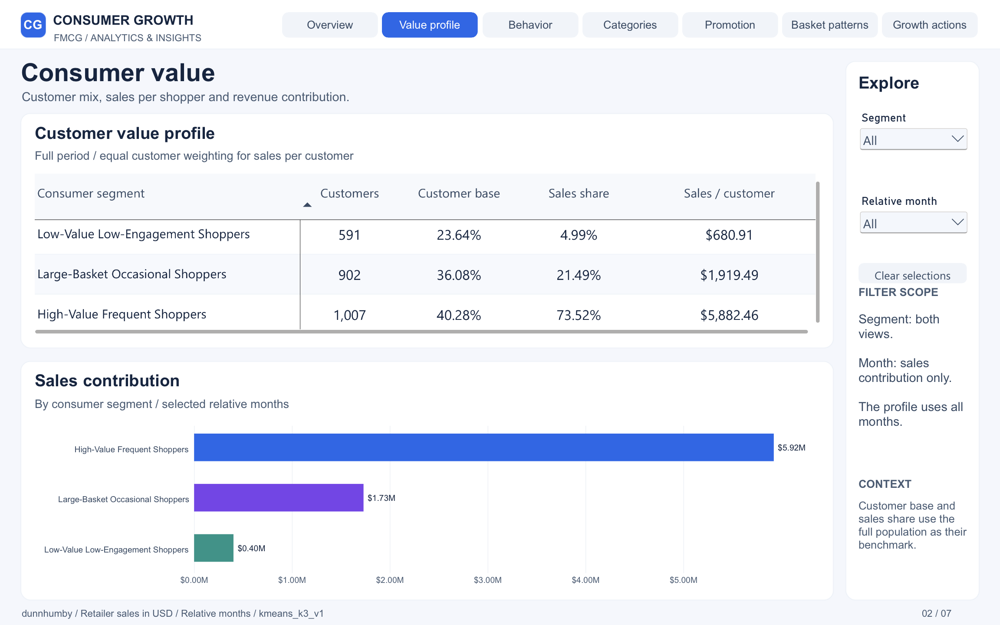](docs/images/02-consumer-value.png)

### Promotion exposure

For Large-Basket Occasional Shoppers, **89.94% of baskets contain a promotional item**, while **51.36% of sales come from promotional lines**, on average per customer. These measures capture different aspects of promotion exposure.

[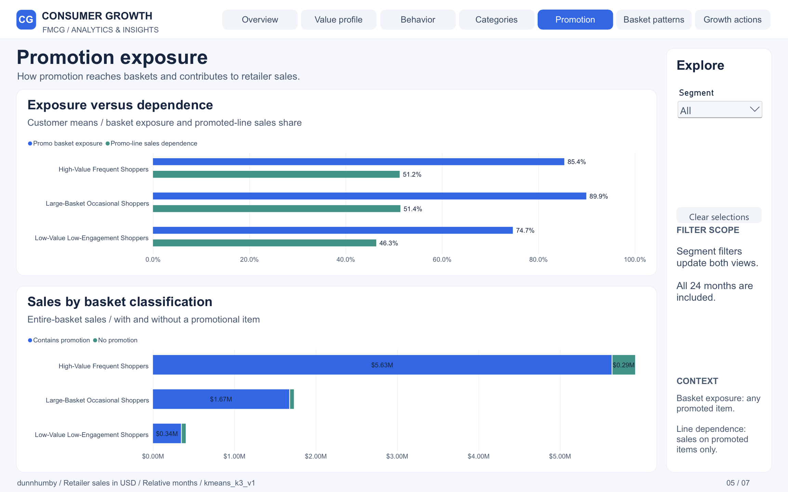](docs/images/05-promotion-exposure.png)

### More dashboard pages

Expand a page to see its screenshot.

<strong>03 · Shopping behavior</strong> — Frequency, recency and basket size

How often each segment shops, how recently it purchased and what its baskets look like.

[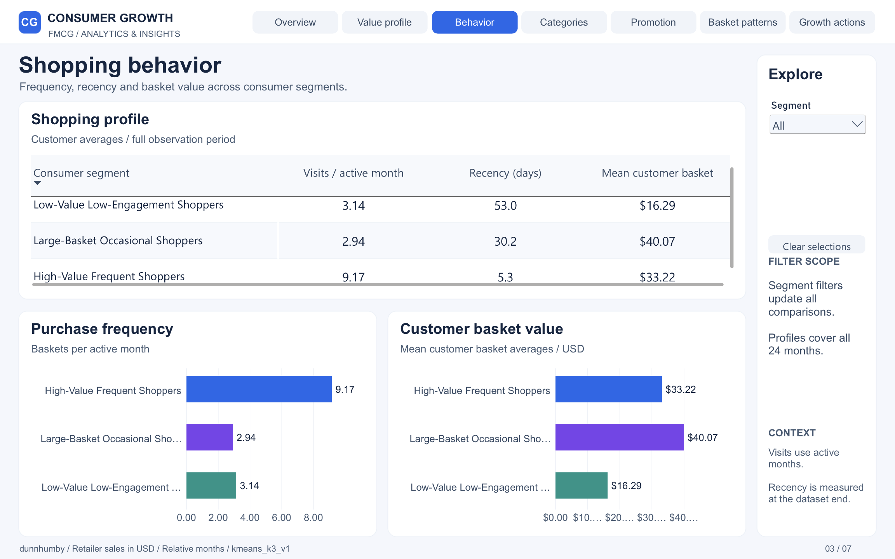](docs/images/03-shopping-behavior.png)

<strong>04 · Category preferences</strong> — What each segment buys

Leading merchandise categories and differences in category preferences across segments.

[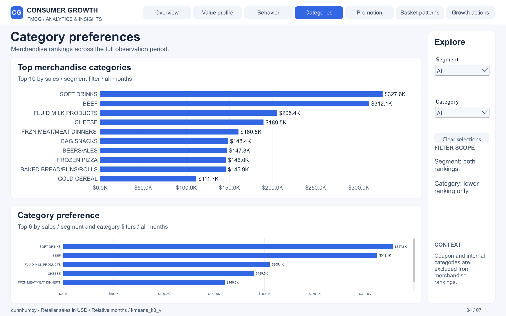](docs/images/04-category-preferences.png)

<strong>06 · Basket comparisons</strong> — Promotional and non-promotional baskets

Observed differences in basket sales and value across segments.

[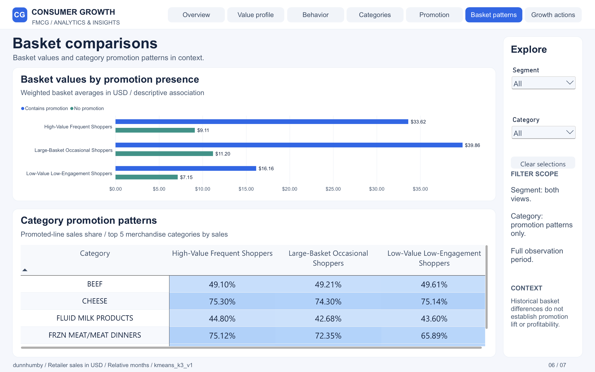](docs/images/06-basket-comparisons.png)

<strong>07 · Growth priorities</strong> — From findings to actions

Three recommendations, their target segments and the KPIs for evaluating them.

[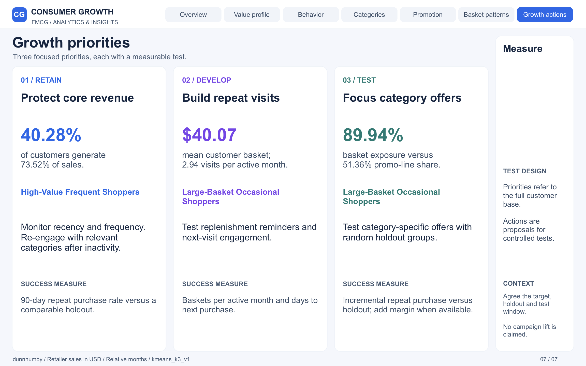](docs/images/07-growth-priorities.png)

**[Explore all seven pages in Power BI][dashboard]**

## The Business Questions

Which shoppers create the most value, how do their shopping and promotion patterns differ, and where should retention and growth efforts focus?

The project combines transaction analysis, behavioral segmentation and promotion comparisons to develop three evidence-based recommendations. Each recommendation identifies a target segment and a KPI for evaluating a future intervention.

## Project at a Glance

| Retailer sales | Households | Baskets | Behavioral segments |
|---:|---:|---:|---:|
| **$8.06M** | **2,500** | **275,889** | **3** |

The project uses **dunnhumby — The Complete Journey**, covering **2,595,732 transaction lines** and repeated purchases by **2,500 households**. Its **eight linked source files** combine transaction records, product/category information, sales, quantities and discounts with campaign, coupon and display/mailer activity. Demographic attributes are available for a subset of households.

Household, basket and product identifiers connect **who buys, what they buy, how often they return and how promotions feature in purchases**. This combination of detailed records and repeated observations supports customer-value analysis, behavioral segmentation, basket composition, category preferences and promotion comparisons across households, baskets and categories.

Reported metrics use the validated analytical population; the full sales control total is **$8,057,443.80**.

## Key Takeaways

### 1. A concentrated revenue base makes retention a priority

**High-Value Frequent Shoppers account for 40.28% of households and 73.52% of sales.** Changes in this group's engagement therefore matter disproportionately to the existing revenue base.

**Recommended action:** Monitor changes in recency and purchase frequency, then test category-relevant re-engagement.

**Evaluation KPI:** 90-day repeat purchase rate.

### 2. Large-basket shoppers offer a visit-frequency opportunity

**Large-Basket Occasional Shoppers average 2.94 baskets per active month**, compared with **9.17** for High-Value Frequent Shoppers. Their shopping pattern supports testing additional visits as a growth opportunity.

**Recommended action:** Test replenishment reminders and next-visit engagement tailored to category preferences.

**Evaluation KPI:** Purchase frequency, measured as baskets per active month.

### 3. Promotional baskets and promotional sales tell different stories

For **Large-Basket Occasional Shoppers**, the average share of baskets containing a promotional item is **89.94%**, while the average share of sales from promotional lines is **51.36%**. A promotional item appearing in a basket does not make the entire basket's sales promotional.

*Both percentages are averages of customer-level shares within the segment.*

**Recommended action:** Test category-specific offers against a holdout group, using promotional-line sales share and category context for targeting.

**Evaluation KPI:** Incremental repeat purchase rate versus the holdout group.

These actions are proposals for controlled testing. The historical analysis does not establish realized sales lift or profitability.

[Read the supporting evidence and recommendations](outputs/insights/03_final_insights_and_recommendations.md).

## Analytical Approach

| Stage | Work completed |
|---|---|
| Data preparation | PostgreSQL raw, staging and analytics layers; documented transaction-validity and metric rules |
| Consumer analysis | Customer value concentration, shopping frequency, basket size, recency and category diversity |
| Segmentation | K-means candidates with three, four and five clusters; three behavioral segments selected using model diagnostics and business interpretation |
| Promotion analysis | Basket exposure, promotional-line sales, category comparisons and two exploratory Kruskal–Wallis tests |
| Communication | Seven-page Power BI report, Excel validation workbook and executive presentation |

## Workflow

The technical workflow connects the source files to the analytical model, business recommendations and final deliverables in this order.

| Step | Technical work |
|---|---|
| **01 · Prepare the environment** | Set up the Python dependencies, PostgreSQL project database and local connection settings. Documented the eight source CSV files and kept raw data outside Git. |
| **02 · Load the raw data** | Used [01_create_schema.sql](sql/01_create_schema.sql) to create the `raw` tables and load the CSV files with `psql` and `\copy`. Preserved source values for traceability. |
| **03 · Build the staging layer** | Used [02_load_staging.sql](sql/02_load_staging.sql) to standardize names and data types, map customer and product records, derive promotion flags and normalize source day indices for relative-period calculations. |
| **04 · Check data quality** | Ran [03_data_quality.sql](sql/03_data_quality.sql) to inspect keys, missing values, quantities, sales and cross-table consistency. Recorded checks and resolutions; behavioral metrics retain lines with `quantity > 0 AND sales_amount >= 0`. |
| **05 · Engineer analytical tables** | Used SQL scripts [04](sql/04_customer_metrics.sql), [05](sql/05_category_metrics.sql) and [06](sql/06_promotion_metrics.sql) to build customer, customer-month, customer-category and promotion metrics. Kept promotional-basket and promotional-line measures distinct. |
| **06 · Explore customer behavior** | Ran [notebook 01](notebooks/01_consumer_behavior_analysis.ipynb) to analyze sales concentration, frequency, basket value, category diversity, promotion dependence and recency. Exported supporting charts and summary tables. |
| **07 · Prepare segmentation features** | In [notebook 02](notebooks/02_consumer_segmentation.ipynb), checked eligibility and six behavioral features. Capped selected tails at the 1st/99th percentiles, applied feature-specific `log1p` transforms and standardized the inputs with `StandardScaler`. |
| **08 · Select and persist segments** | Compared K-means with `k = 3, 4, 5`, `random_state = 42` and `n_init = 50`. Reviewed silhouette scores, cluster sizes and business profiles; selected three segments and wrote assignments to `analytics.customer_segments`. |
| **09 · Analyze promotion patterns** | Ran [notebook 03](notebooks/03_promotion_analysis.ipynb) to compare exposure, sales shares and basket values by segment and category. Used two exploratory Kruskal–Wallis tests with effect sizes to assess differences. |
| **10 · Develop recommendations** | Consolidated the evidence into [three final insights](outputs/insights/03_final_insights_and_recommendations.md), each with a target segment, proposed action and evaluation KPI. |
| **11 · Build the Power BI project** | Connected the analytical tables to an Import model with shared dimensions, two fact tables and four single-direction relationships. Added explicit DAX measures and organized the report into seven pages. |
| **12 · Reconcile results in Excel** | Compared key sales, basket, segment and promotion metrics with the analytical outputs using formula-based controls and reconciliation checks. |
| **13 · Prepare the executive presentation** | Developed the final 12-slide presentation around the business problem, analysis, findings and three recommended actions. |
| **14 · Publish and document** | Published the interactive report and prepared the code, analytical evidence and supporting documentation for portfolio review. |

## Analysis files

| Explore | Contents |
|---|---|
| [SQL workflow](sql/) | Six scripts covering ingestion, data quality and analytical tables |
| [Python notebooks](notebooks/) | Consumer behavior, segmentation and promotion analysis |
| [Tables and validation](outputs/tables/) | Segment profiles, statistical results and metric reconciliation |
| [Analytical charts](outputs/figures/) | Supporting visual evidence |
| [Data documentation](data/README.md) | Source files, definitions and analytical rules |

### Selected analytical outputs

Six examples from the Python analysis show the evidence behind the dashboard and recommendations.

| Purchase frequency and customer value | Historical customer value and recency |
|---|---|
| 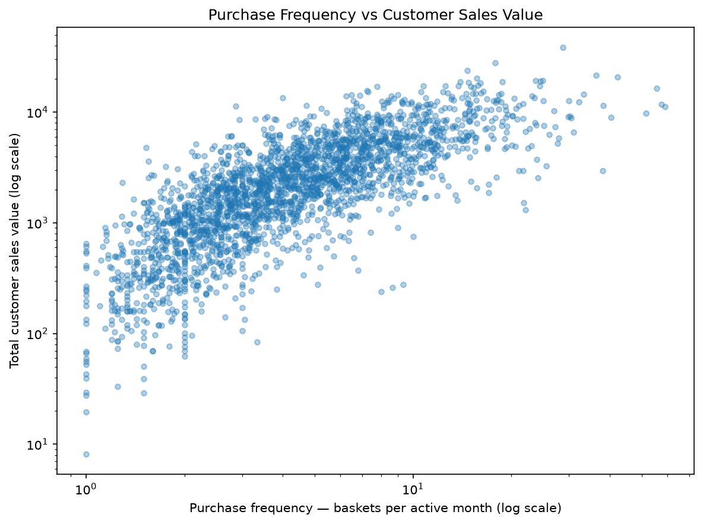 | 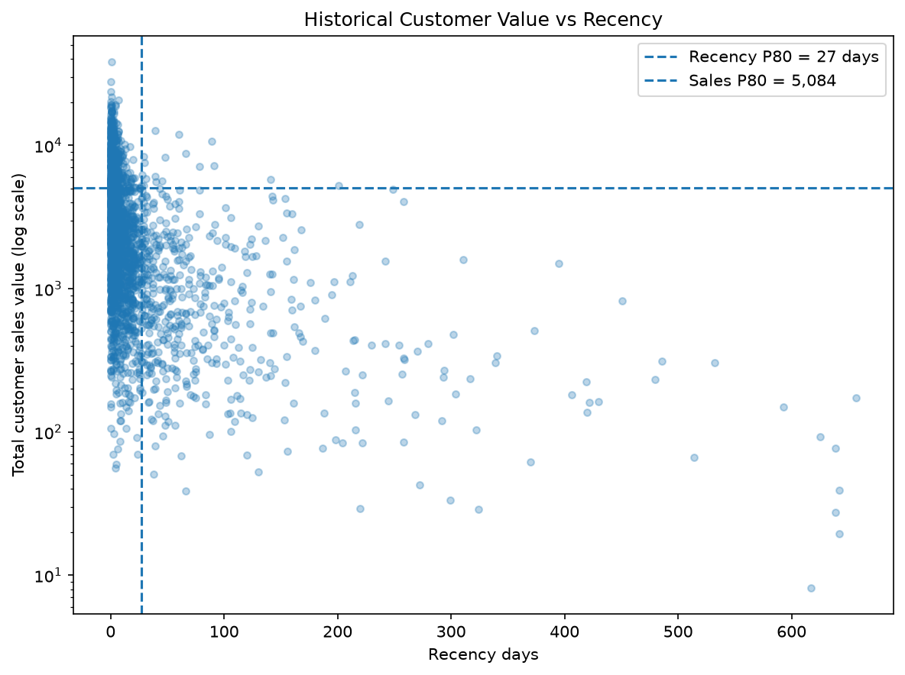 |
| More frequent shopping is associated with higher historical customer sales. Both axes use logarithmic scales. | Historical sales are compared with days since the last purchase; dashed lines mark the 80th percentiles. |

| Average basket value distribution | Average items per basket by segment |
|---|---|
| 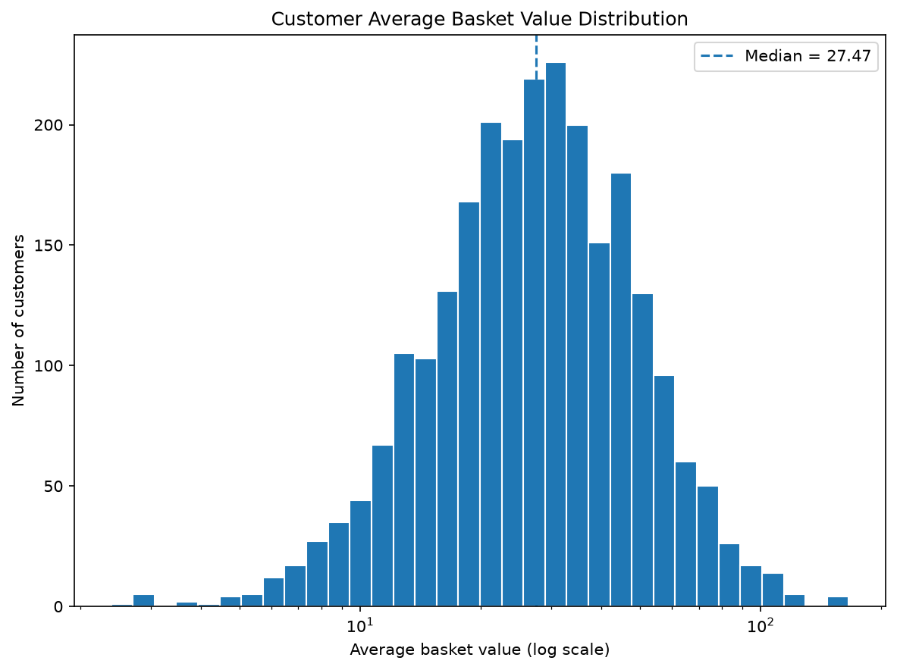 | 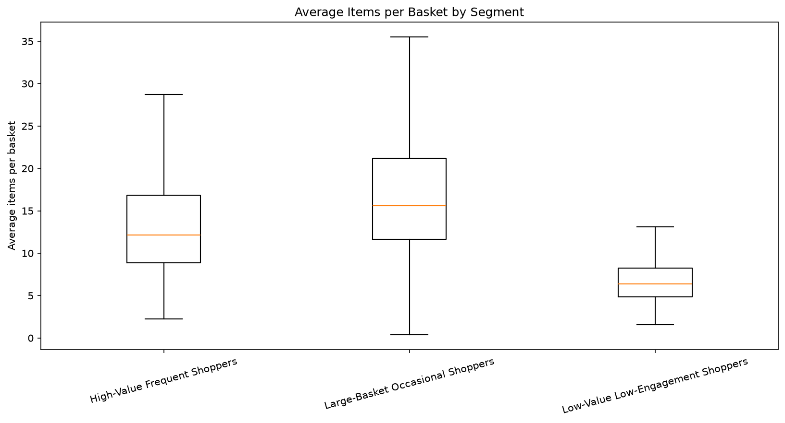 |
| Customer-level average basket values are shown on a logarithmic scale; the dashed line marks the median. | Box plots compare customer-level average items per basket, showing differences in typical basket size and variation within each segment. |

| Customer sales concentration | Segment behavioral profiles |
|---|---|
| 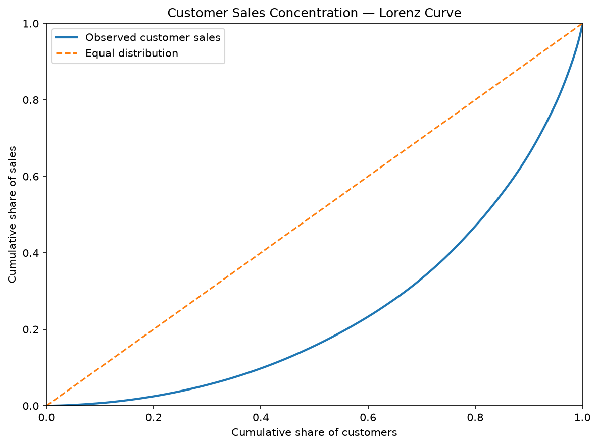 | 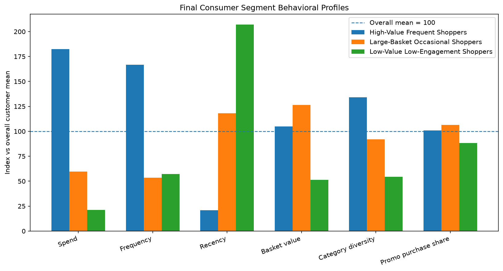 |
| The Lorenz curve shows how unevenly sales are distributed across households. | Six metrics are indexed to an overall customer mean of 100. Higher recency means more time since the last purchase. |

[Browse all 13 analytical figures](outputs/figures/).

<!-- Add direct links to the approved PBIP project, Excel workbook and final
12-slide presentation after the files are committed to the repository. -->

## Reproducing the Analysis

View prerequisites and execution order

The repository includes saved notebook outputs and analytical tables. A fresh run requires the original source data and a configured PostgreSQL database.

1. Obtain the source dataset and place the eight CSV files described in [data/README.md](data/README.md) under `data/raw/`.
2. Set up Python and install the packages listed in [requirements.txt](requirements.txt).
3. Create a dedicated project database. Copy [.env.example](.env.example) to `.env` and supply your local PostgreSQL connection values.
4. Run the six SQL files in numeric order, from `01_create_schema.sql` through `06_promotion_metrics.sql`, from the repository root. Use `psql`: the first script contains client-side `\copy` commands for loading CSV files. The scripts rebuild project tables, so use the dedicated database.
5. Run the notebooks from top to bottom in this order: `01_consumer_behavior_analysis.ipynb`, `02_consumer_segmentation.ipynb`, then `03_promotion_analysis.ipynb`. Start from the repository root or the `notebooks/` directory. The segmentation notebook writes customer assignments back to PostgreSQL.
6. Review the regenerated outputs and compare the core metrics with [powerbi/powerbi_validation_targets.csv](powerbi/powerbi_validation_targets.csv).

Raw source files and local connection credentials are excluded from Git.

## Interpretation Notes

- **Sales** represent retailer receipts, not customer out-of-pocket payments or profit.
- **Promotion comparisons** describe historical associations; they do not establish causal promotion lift.
- **Time** is expressed in relative periods because the source provides sequential day indices rather than documented calendar dates. Trend comparisons should use comparable observed periods.
- **Segments** summarize behavior in the observed dataset and should be reassessed when applied to new data.

Source: **dunnhumby — The Complete Journey**. See [data documentation](data/README.md) for source-file coverage and analytical rules.

[dashboard]: https://app.powerbi.com/view?r=eyJrIjoiMGFiNjk2MzYtOTg2Ny00MWJlLWIyZmYtODY1YTZmMGQwZjc2IiwidCI6IjdjMDY0MDFiLTYwMDMtNDAxYy1hZWJiLWQzZmI3NDEzZDYxMSJ9
