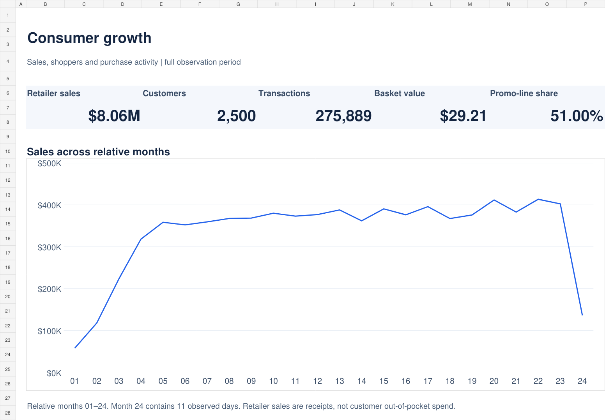
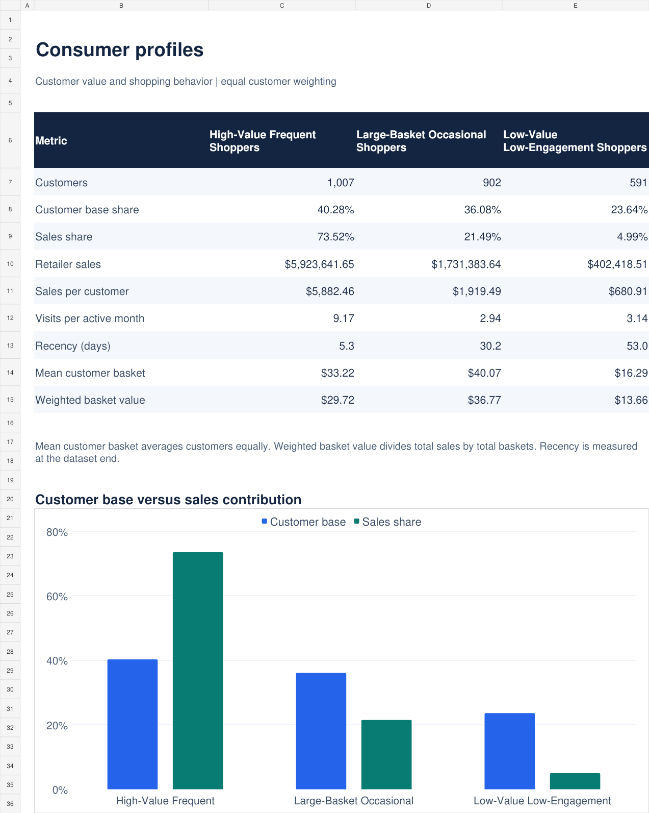
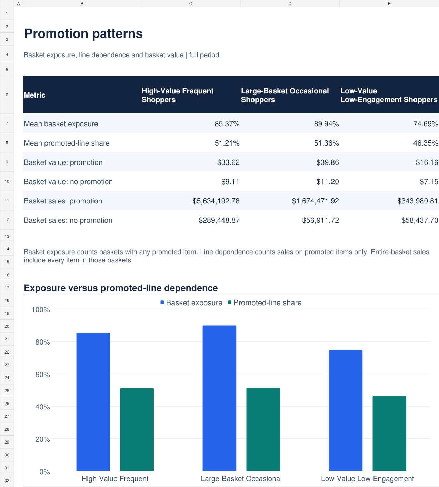
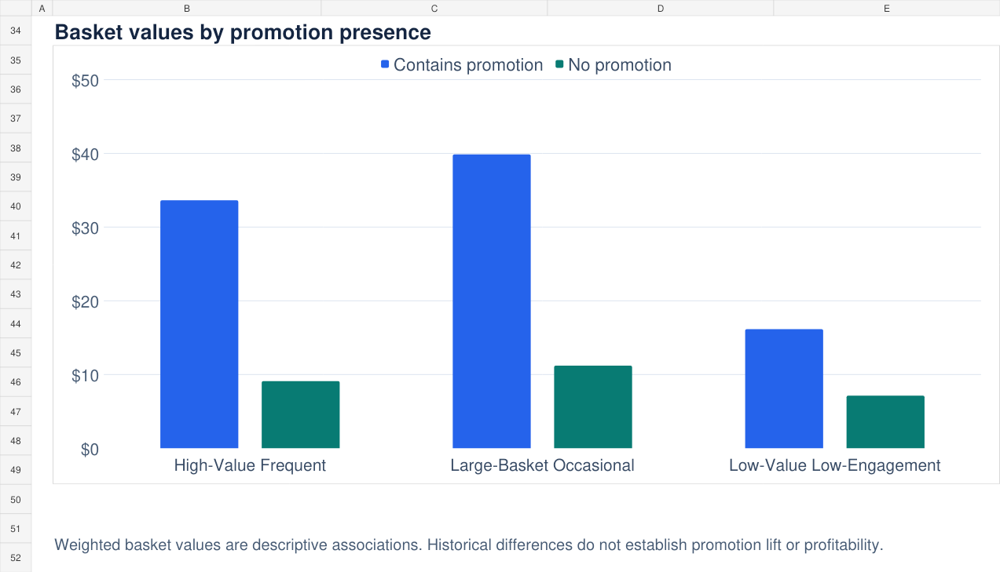
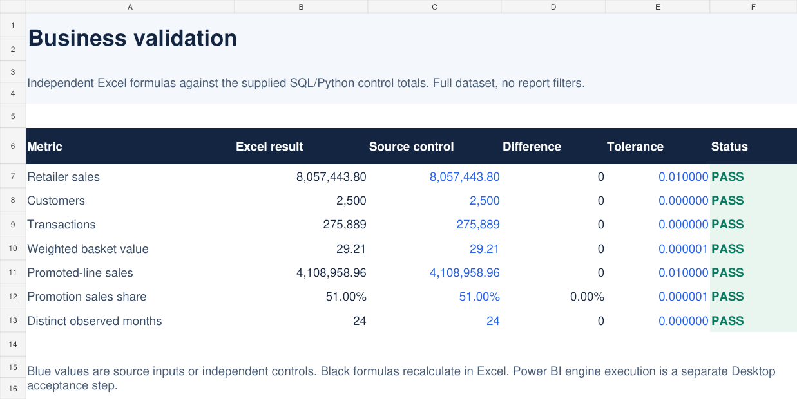
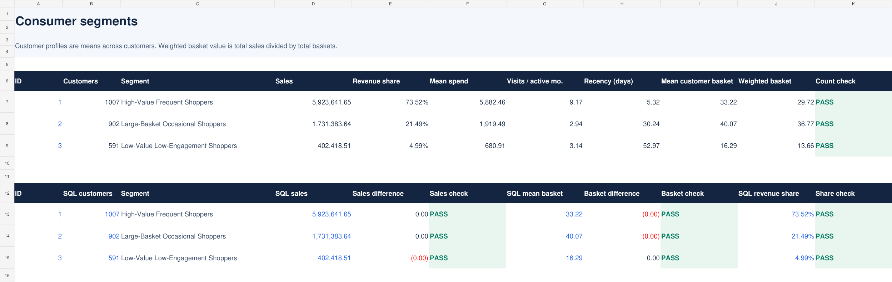
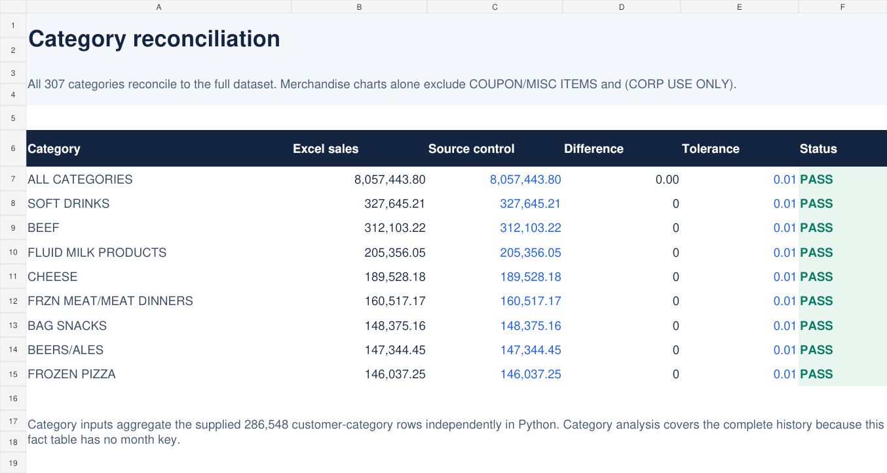
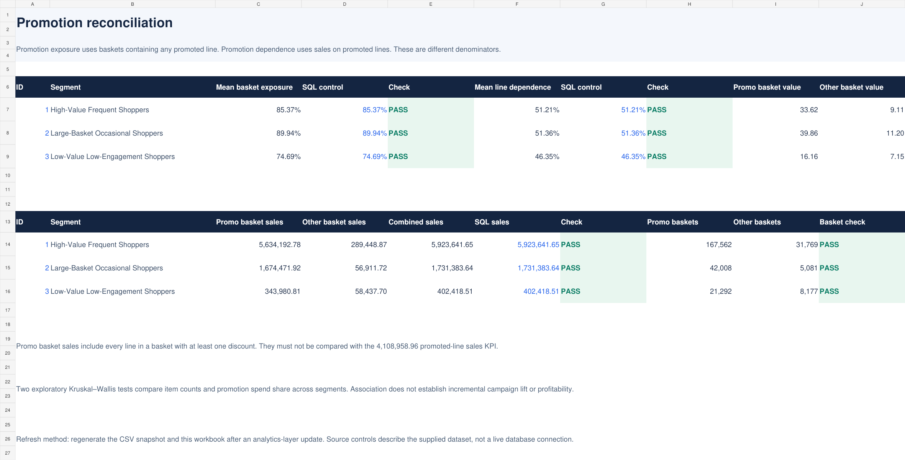

# Business Validation Workbook

**FMCG Consumer Growth & Promotion Insights**

Seven worksheets combine customer and promotion analysis across 2,500 households with formula-based checks against the project's SQL and Python reference totals. Three analytical views present the findings, while four validation sheets make the supporting calculations available for review.

**[Download Excel](https://raw.githubusercontent.com/sudenazcaglar/fmcg-growth-insights/main/excel/business_validation.xlsx)** · [View the live dashboard][dashboard] · [Executive presentation](../presentation/README.md) · [Project overview](../README.md)

## Explore the workbook

### 01 · Overview

Retailer sales, customers, purchase occasions and monthly activity in one view.

### 02 · Consumer profiles

Compare three shopper groups by sales contribution, spending, visit frequency and recency.

### 03 · Promotion patterns

Customer averages distinguish the share of baskets containing a promoted item from the share of spending on promoted items.

### 04 · Basket-value comparisons

The second view of **Promotion patterns** compares weighted basket values by promotion status within each segment. These differences describe associations; they do not measure campaign lift.

## Validation worksheets

These four sheets compare recalculated results with the supplied reference totals. Each preview shows the sheet's summary area; supporting records are available in the workbook.

<strong>05 · KPI checks</strong>

`01_KPI_Check` reconciles sales, customer and basket counts, weighted basket value and promotion metrics, with explicit differences and tolerances.

<strong>06 · Segment reconciliation</strong>

`02_Segment_Summary` calculates segment profiles from the included customer records and checks customer counts, sales, mean basket values and sales shares.

<strong>07 · Category reconciliation</strong>

`03_Category_Check` reconciles total sales across 307 categories and checks leading-category totals against the reference values.

<strong>08 · Promotion reconciliation</strong>

`04_Promotion_Check` checks promotion exposure, promoted-item spending shares and the sales and basket totals split by promotion status.

## Using the workbook

Download the file and open it in Excel to inspect the formulas, charts and supporting data. It contains a saved data snapshot; changes to the database or dashboard do not automatically refresh the workbook.

[dashboard]: https://app.powerbi.com/view?r=eyJrIjoiMGFiNjk2MzYtOTg2Ny00MWJlLWIyZmYtODY1YTZmMGQwZjc2IiwidCI6IjdjMDY0MDFiLTYwMDMtNDAxYy1hZWJiLWQzZmI3NDEzZDYxMSJ9
