# Executive Presentation

**FMCG Consumer Growth & Promotion Insights**

A 12-slide presentation of the analysis across 2,500 households, connecting customer value, shopping behavior and promotion patterns to retention and growth priorities. The closing slides translate the findings into three proposed tests with clear evaluation measures.

**[Download PowerPoint](consumer_growth_executive.pptx?raw=true)** · [View the live dashboard][dashboard] · [Project overview](../README.md)

## Overview and segmentation

| 01 · Executive overview | 02 · Data and analytical approach |
|---|---|
| [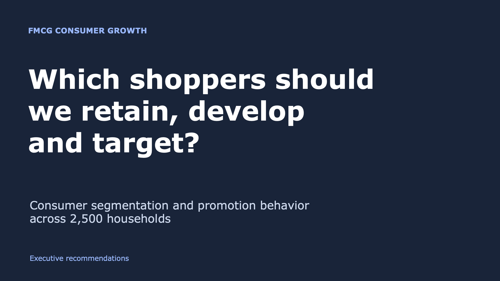](images/slide-01.png) | [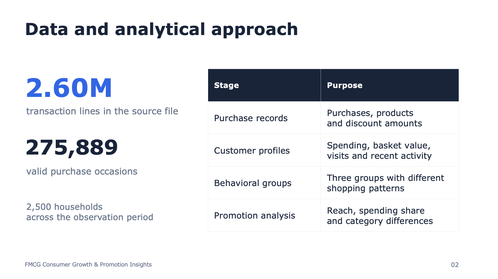](images/slide-02.png) |
| The business question behind the analysis and recommendations. | Purchase records, customer profiles, behavioral groups and promotion analysis. |

| 03 · Sales concentration | 04 · Segment priorities |
|---|---|
| [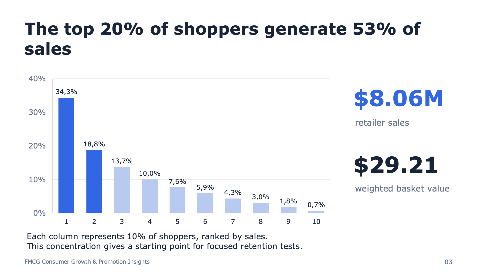](images/slide-03.png) | [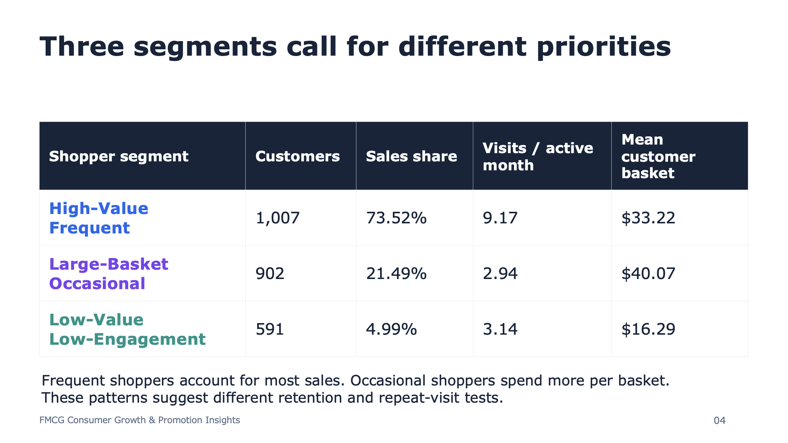](images/slide-04.png) |
| The top 20% of shoppers account for approximately 53% of retailer sales. | Three groups differ in sales contribution, visit frequency and basket value. |

## Shopping and promotion behavior

| 05 · Frequency and customer value | 06 · Recency and engagement |
|---|---|
| [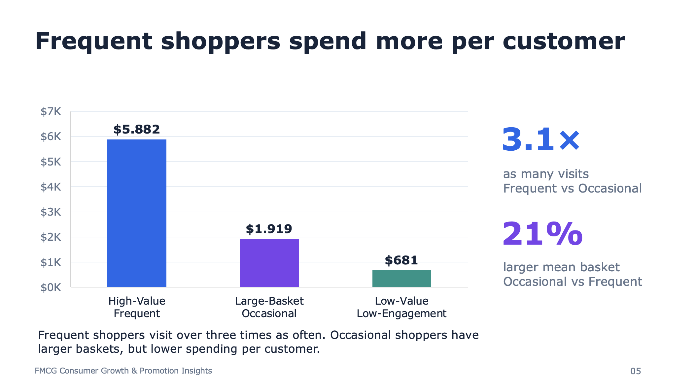](images/slide-05.png) | [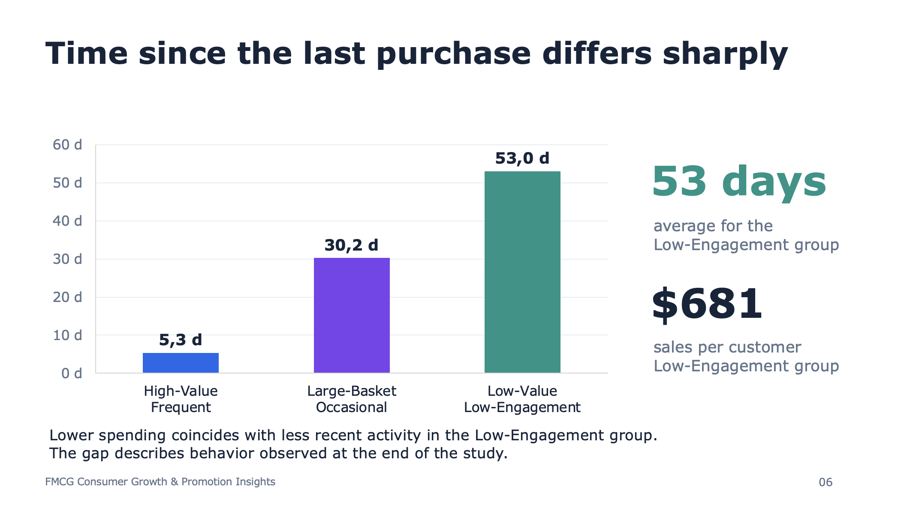](images/slide-06.png) |
| More frequent visits accompany higher customer spending. | Lower customer spending coincides with less recent shopping activity. |

| 07 · Category preferences | 08 · Promotion reach |
|---|---|
| [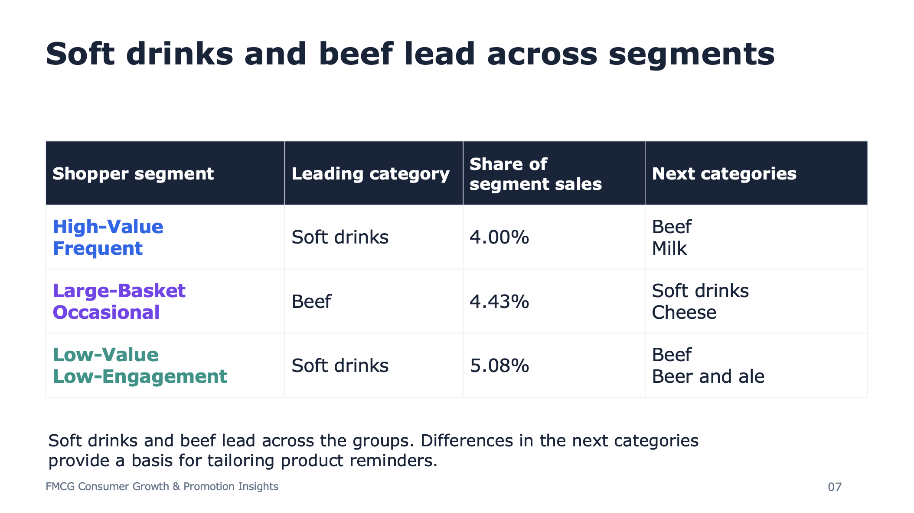](images/slide-07.png) | [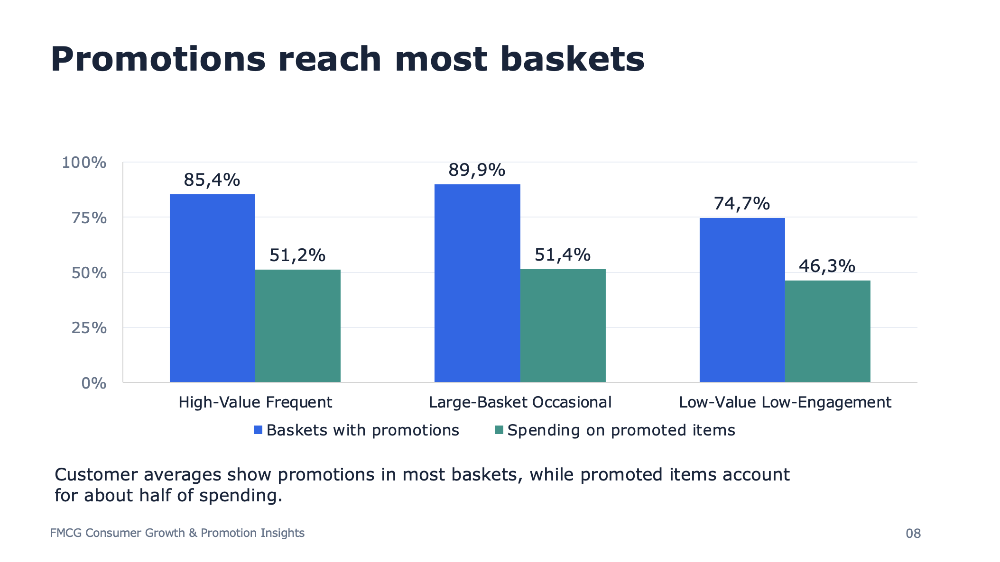](images/slide-08.png) |
| Leading categories provide a basis for tailoring product reminders. | Customer averages distinguish basket exposure from spending on promoted items. |

## Comparisons and recommendations

| 09 · Basket-value comparisons | 10 · Category promotion patterns |
|---|---|
| [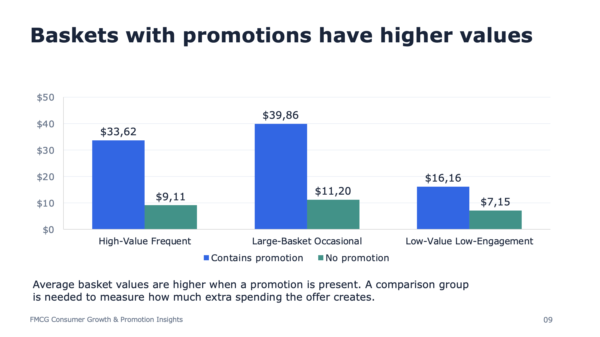](images/slide-09.png) | [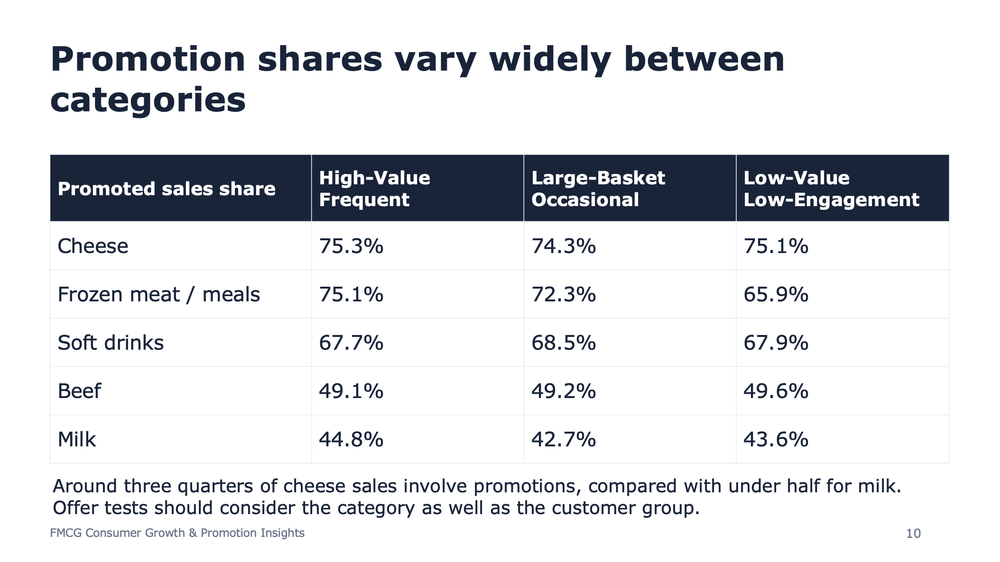](images/slide-10.png) |
| Basket values differ by promotion status; controlled tests are needed to measure offer effects. | Promoted sales shares differ substantially between merchandise categories. |

| 11 · Business implications | 12 · Actions and measurement |
|---|---|
| [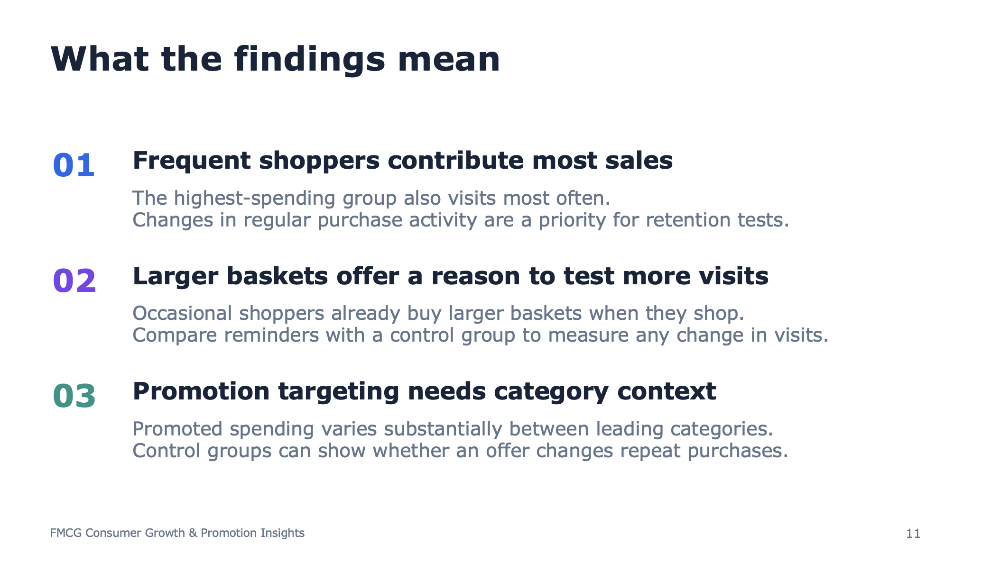](images/slide-11.png) | [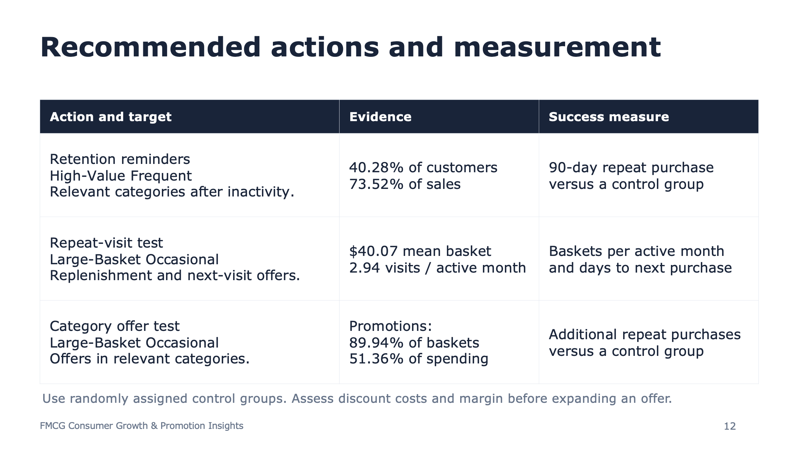](images/slide-12.png) |
| The findings suggest distinct retention, repeat-visit and targeting priorities. | Three proposed tests connect target shoppers, actions and evaluation metrics. |

[dashboard]: https://app.powerbi.com/view?r=eyJrIjoiMGFiNjk2MzYtOTg2Ny00MWJlLWIyZmYtODY1YTZmMGQwZjc2IiwidCI6IjdjMDY0MDFiLTYwMDMtNDAxYy1hZWJiLWQzZmI3NDEzZDYxMSJ9
